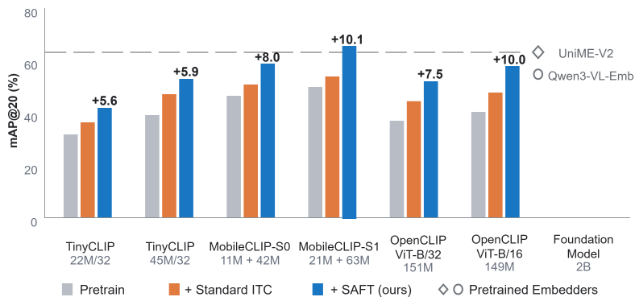

# SAFT: Rethinking Text-Based Image Retrieval in Specific Domain

This repository is the official implementation of [*Rethinking Text-Based Image Retrieval in Specific Domain*](https://arxiv.org/pdf/2608.10524).

## Contents

- [Overview](#overview)
- [Released Components](#released-components)
- [Usage](#usage)
  - [Getting Started](#getting-started)
    - [Installation](#installation)
    - [Prepare Resources](#prepare-resources)
  - [Training & Evaluation](#training--evaluation)
    - [Evaluation](#evaluation)
    - [Fine-tuning](#fine-tuning)
- [Documentation](#documentation)
- [License](#license)
- [Acknowledgements](#acknowledgements)
- [Citation](#citation)

## Overview

We introduce **Semantic-Aware Fine-Tuning (SAFT)**, a framework for adapting lightweight CLIP models to domain-specific text-based image retrieval (TBIR) applications. We also present **SecMM-TBIR**, a large-scale surveillance benchmark with 50K images, 200 queries, and verified multi-match relevance labels for pedestrian and vehicle retrieval. The current implementation supports the TinyCLIP, OpenCLIP, and MobileCLIP model families.

<p align="center">
  
</p>
<p align="center"><em><strong>Figure 1.</strong> SAFT improves CLIP models by an average of 7.8 mAP@20 over standard ITC fine-tuning, enabling MobileCLIP-S1 to outperform 2B pretrained embedders on SecMM-TBIR.</em></p>

## Released components

- ✅ Evaluation code
- ✅ Fine-tuning code
- ✅ SecMM-TBIR benchmark
- ✅ Best MobileCLIP-S1 weights (`.pt`)
- ✅ Sample training set for running the fine-tuning pipeline
- ❌ Complete internal training dataset used in the paper

The full internal training dataset cannot be released publicly due to security constraints. We provide a sample dataset that allows users to run the fine-tuning pipeline and verify its implementation. Download the released data and weights from [Google Drive](https://drive.google.com/file/d/1OtxO45zbwkR5gzj7rzTrNXfRJgJgQIlU/view?usp=drive_link).

## Usage

### Getting started

#### Installation

Create a Conda environment and install the required dependencies:

```bash
# Create and activate the Conda environment
conda create -n saft python=3.12 -y
conda activate saft

# Install PyTorch
python -m pip install torch==2.5.1 torchvision==0.20.1 --index-url https://download.pytorch.org/whl/cu121

# Install project dependencies
python -m pip install -r requirements.txt

# Install MobileCLIP
python -m pip install ./third_party/ml-mobileclip-main
```

#### Prepare resources

Download `resources.zip` from [Google Drive](https://drive.google.com/file/d/1OtxO45zbwkR5gzj7rzTrNXfRJgJgQIlU/view?usp=drive_link) and extract it into the repository root. The resulting directory structure should be:

```text
resources/
├── datasets/
│   ├── training/
│   │   └── sample/
│   │       ├── train/
│   │       └── val/
│   └── evaluation/
│       ├── SecMM-TBIR/
│       └── general-domain/
│           ├── mscoco-test/
│           └── flickr-test/
└── models/
    ├── foundation/
    │   ├── tinyclip/
    │   ├── openclip/
    │   └── mobileclip/
    └── finetuned/
        └── mobileclip_s1/
```

### Training & Evaluation

#### Evaluation

We report mAP@K for the pedestrian and vehicle subsets of SecMM-TBIR, and Recall@K for the general-domain MSCOCO and Flickr30K benchmarks. The following commands evaluate the released SAFT MobileCLIP-S1 weights.
```bash
# Evaluate mAP@K on SecMM-TBIR
python tools/evaluation/evaluate.py \
  --config configs/evaluation/mobileclip.json \
  --task map \
  --finetuned-weight-path resources/models/finetuned/mobileclip_s1/best_overall.pt \
  --top-k 10 \
  --output tmp/evaluation/mobileclip_s1_map.json

# Evaluate Recall@K on MSCOCO and Flickr30K
python tools/evaluation/evaluate.py \
  --config configs/evaluation/mobileclip.json \
  --task recall \
  --finetuned-weight-path resources/models/finetuned/mobileclip_s1/best_overall.pt \
  --top-k 10 \
  --output tmp/evaluation/mobileclip_s1_recall.json
```

**Main results on SecMM-TBIR**: The table compares each foundation model with its SAFT-fine-tuned counterpart.

| Model | Pedestrian<br>mAP@10 (%) | Pedestrian<br>mAP@20 (%) | Pedestrian<br>mAP@30 (%) | Vehicle<br>mAP@10 (%) | Vehicle<br>mAP@20 (%) | Vehicle<br>mAP@30 (%) |
|:------|:------------------------:|:------------------------:|:------------------------:|:---------------------:|:---------------------:|:---------------------:|
| TinyCLIP-22M/32 | 32.5 | 25.1 | 23.3 | 45.4 | 38.0 | 33.5 |
| **↳ + SAFT (ours)** | **40.7** | **32.1** | **29.6** | **60.1** | **51.3** | **45.8** |
| TinyCLIP-45M/32 | 40.0 | 32.7 | 30.4 | 53.3 | 45.2 | 40.2 |
| **↳ + SAFT (ours)** | **50.5** | **41.5** | **38.4** | **73.3** | **64.6** | **58.5** |
| MobileCLIP-S0 | 49.7 | 41.0 | 38.5 | 60.1 | 52.2 | 46.5 |
| **↳ + SAFT (ours)** | **59.8** | **49.7** | **46.7** | **77.7** | **67.9** | **61.7** |
| MobileCLIP-S1 | 52.1 | 42.6 | 39.8 | 65.2 | 57.2 | 51.7 |
| **↳ + SAFT (ours)** | **65.0** | **54.9** | **52.1** | **79.2** | **73.0** | **66.8** |
| OpenCLIP-B/32 | 34.0 | 27.4 | 25.5 | 55.6 | 46.5 | 41.6 |
| **↳ + SAFT (ours)** | **47.5** | **39.0** | **36.3** | **73.1** | **64.8** | **58.5** |
| OpenCLIP-B/16 | 40.5 | 32.9 | 30.4 | 56.4 | 48.0 | 42.9 |
| **↳ + SAFT (ours)** | **57.9** | **46.9** | **44.0** | **75.4** | **68.7** | **62.8** |

#### Fine-tuning

Run the demonstration MobileCLIP training configuration with the released sample training set:

```bash
python train.py \
  --config configs/train/mobileclip.json \
  --devices 0 \
  --num_workers 4
```

For details on the training configuration and data format, see [Training and data format](docs/training.md).

## Documentation

- [Training and data format](docs/training.md)
- [Evaluation protocol](docs/evaluation.md)
- [SecMM-TBIR benchmark](docs/benchmark.md)
- [Third-party components](third_party/README.md)


## License

This source code and accompanying data and models have been released under the
following licenses:
- Code: [MIT](./LICENSE)
- Models: License files are included with the released model weights.
- Data: License and source attribution files are included with the released datasets.


## Acknowledgements

This repository supports models from [TinyCLIP](https://github.com/wkcn/TinyCLIP), [OpenCLIP](https://github.com/mlfoundations/open_clip), and [Apple MobileCLIP](https://github.com/apple-aiml-research/ml-mobileclip). Please follow the licenses included with each third-party component and model.

## Citation

If you find this work useful, please cite:

```bibtex
@article{tan2026rethinking,
  title={Rethinking Text-Based Image Retrieval in Specific Domain},
  author={Tan, Jingyang and Yang, Sheng and Chen, Yuanpeng and Wang, Jian and Ye, Nianjin and Xing, Chen and Jia, Lanpeng},
  journal={arXiv preprint arXiv:2608.10524},
  year={2026}
}
```
