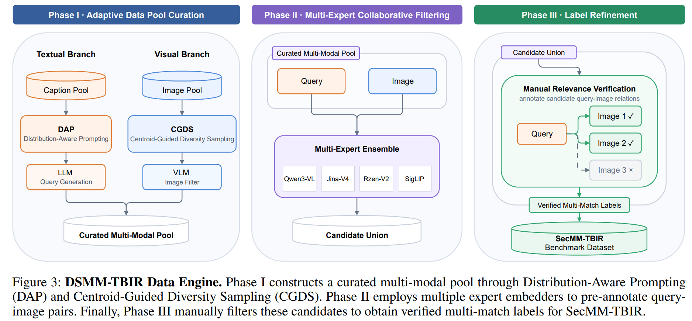
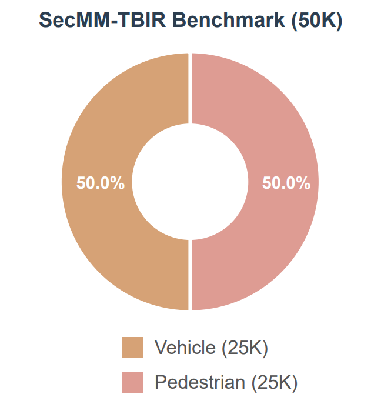
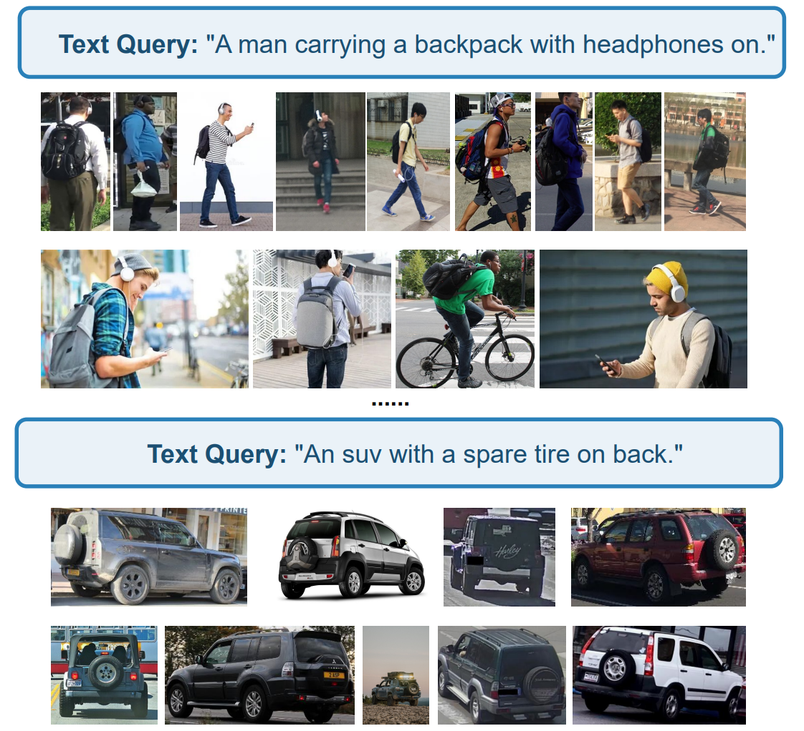

# SecMM-TBIR Benchmark

SecMM-TBIR is a large-scale, multi-match text-based image retrieval benchmark designed for surveillance scenarios. It contains **50,000 gallery images** and **200 text queries** across two subsets:

* **Pedestrian retrieval:** 25,000 images
* **Vehicle retrieval:** 25,000 images

Unlike conventional benchmarks that assume a single matching image for each query, SecMM-TBIR provides manually verified relevance annotations with multiple positive images per query. Retrieval performance is evaluated using **mAP@K**.

## Benchmark Construction

SecMM-TBIR is constructed using the **DSMM-TBIR data engine**, which consists of three main stages:

1. **Representative pool construction:** Distribution-Aware Prompting (DAP) and Centroid-Guided Diversity Sampling (CGDS) are used to build a diverse multimodal candidate pool.
2. **Multi-expert candidate retrieval:** Multiple expert embedding models retrieve candidate images for each text query.
3. **Manual relevance verification:** The retrieved candidates are manually reviewed to produce reliable multi-match relevance annotations.

<p align="center">
  
</p>

## Benchmark Composition and Examples

<table>
  <tr>
    <td width="50%" valign="top">
      <strong>Benchmark composition.</strong> SecMM-TBIR is evenly divided into pedestrian and vehicle subsets, each containing 25,000 gallery images.
    </td>
    <td width="50%" valign="top">
      <strong>Multi-match annotations.</strong> Each text query can correspond to multiple relevant images in the gallery.
    </td>
  </tr>
  <tr>
    <td width="50%" align="center" valign="top">
      
    </td>
    <td width="50%" align="center" valign="top">
      
    </td>
  </tr>
</table>

## Directory Structure

```text
resources/datasets/evaluation/SecMM-TBIR/
├── images/
│   ├── pedestrian/
│   └── vehicle/
├── label/
│   ├── gt_pedestrian.json
│   └── gt_vehicle.json
└── query/
    ├── pedestrian_queries.txt
    └── vehicle_queries.txt
```

## Ground-Truth Files

Ground-truth is stored as a non-empty JSON array:

```json
[
  {
    "text_query": "a_pedestrian_wearing_a_red_top",
    "image_name": [
      "000001.jpg",
      "000017.jpg"
    ]
  }
]
```


## Evaluation Metric

For each query, all gallery images are ranked by text-image similarity. **Average Precision at K (AP@K)** is computed over the top `K` retrieved images, and **mAP@K** is obtained by averaging AP@K across all queries.
